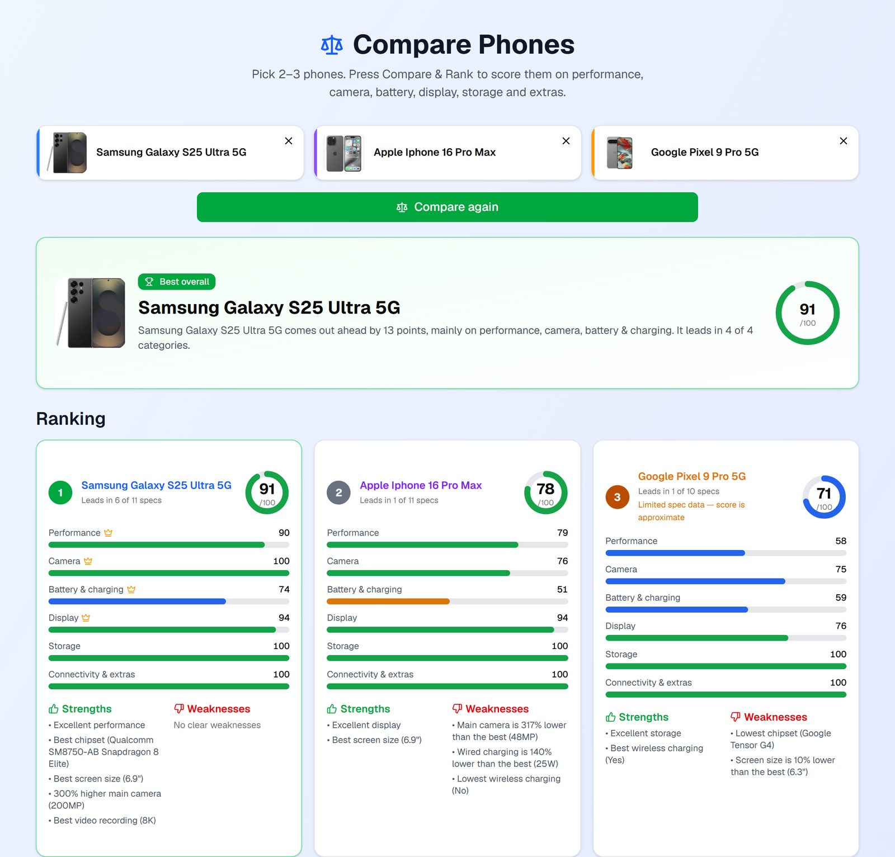

# nicklee-product-pipeline

The tools behind product listing on [nicklee.co.ke](https://nicklee.co.ke), a Kenyan electronics shop. An AI agent takes
"post Galaxy A16 at 18,500", finds the specs and photos, cleans the image and publishes the product live, work that was
previously done by hand. The research site is live at [nickleecoke.vercel.app](https://nickleecoke.vercel.app).



## Architecture

1. **Research site** (this repo, Next.js on Vercel): spec search, phone scoring, image search, server-side image proxy.
2. **bg-service** (Python, Docker on a VPS): background removal with InSPyReNet, returns a white 1000×1000 product image.
3. **ig-service** (Python, Docker on the same VPS): Instagram image search through a rotating pool of logged-in accounts.
4. **Catalog API** (the shop's Laravel backend): creates products and sets prices and stock, logging every change.
5. **The agent** (Claude with a written skill): uses 1–3 to find and clean the photo, 4 to publish it, then checks the live page.

## What's in this repo

- **Phone search and comparison** (`/`, `/compare`): specs from GSMArena and other sites, scored across performance,
  camera, battery, display, storage and extras (`lib/phone-scoring.ts`).
- **Net images and laptops** (`/images`, `/laptops`): product images, details and a copyable description.
- **Instagram images** (`/instagram`): image search backed by `instagram-service/` (see below).
- **Background removal** (`bg-service/`): turns a product photo into a white square with the product centred.

Built with Next.js, TypeScript, Tailwind CSS and shadcn/ui; the two services are Python (Flask) in Docker.

## Getting Started

```bash
pnpm install
pnpm dev
```

Open [http://localhost:3000](http://localhost:3000). A push to `main` deploys to Vercel.

## Instagram images (Instagram page)

The /instagram page searches Instagram (keyword search plus matching hashtags) and shows the posts' images. It uses [Instaloader](https://github.com/instaloader/instaloader) in a small separate service (`instagram-service/`), because Instaloader is Python and needs a long-running host (not Vercel).

1. Deploy `instagram-service/` anywhere that runs Docker/Python. Set `SERVICE_TOKEN` (any long random string), `IG_USER` + `IG_SESSIONFILE` (required, Instagram search needs a login; create the session file with `instaloader --login=YOUR_USER`). See the header of `instagram-service/app.py` for every option.
2. In the Next.js project set `INSTAGRAM_SERVICE_URL` (the service's URL) and `INSTAGRAM_SERVICE_TOKEN` (same as `SERVICE_TOKEN`).

Instagram rate-limits and blocks scraping, so results are cached for 30 minutes and each search reads only a few pages. Use a dedicated Instagram account for the login, not your main one.
